# Marmitech no Kubernetes (Minikube)

Projeto de implantação da aplicação Marmitech em cluster Kubernetes local utilizando o Minikube.

---

## Pré-requisitos

Para rodar este projeto na sua máquina, você precisa ter instalado:

* [Docker](https://docs.docker.com/get-docker/)
* [Minikube](https://minikube.sigs.k8s.io/docs/start/)
* [kubectl](https://kubernetes.io/docs/tasks/tools/)

---

## Passo a Passo para Executar

### 1. Iniciar o Minikube

Abra o terminal e execute:

```bash
minikube start --driver=docker
```

### 2. Construir as Imagens no Minikube

Para que o cluster enxergue as imagens sem precisar enviá-las para a internet, construa direto no Minikube:

```bash
# Frontend
minikube image build -t marmitech-web:1.0 ./marmitech-web

# Backend
minikube image build -t marmitech-api:1.0 ./marmitech-api
```

### 3. Aplicar os Manifestos do Kubernetes

Aplique todos os manifestos recursivamente:

```bash
kubectl apply -f k8s/ --recursive
```

*(Isso cria o Banco MySQL com seu PVC e Secret, a API com 2 réplicas, e o Frontend com 2 réplicas e NodePort).*

### 4. Verificar se está tudo rodando

```bash
kubectl get pods -o wide
kubectl get services
kubectl get deployments
kubectl get pvc
```

### 5. Acessar a Aplicação

Para abrir o frontend no navegador:

```bash
minikube service marmitech-web
```

Ou acesse diretamente pelo IP do Minikube na porta `30080` (exemplo: `http://192.168.49.2:30080`).

---

## Demonstrações Práticas para Apresentação

### 1. Testar a Autorrecuperação (Self-Healing)

Para demonstrar que o Kubernetes recria um Pod excluído automaticamente:

1. Veja o nome do Pod atual:

   ```bash
   kubectl get pods -l app=marmitech-api
   ```

2. Delete o Pod:

   ```bash
   kubectl delete pod <nome-do-pod>
   ```

3. Veja o novo Pod sendo criado em tempo real:

   ```bash
   kubectl get pods -w
   ```

### 2. Demonstrar o Balanceamento de Carga (Load Balancing)

Execute no terminal para ver a alternância entre os Pods da API em tempo real:

```bash
for i in $(seq 1 6); do curl -s http://$(minikube ip):30080/backend/health; echo ""; sleep 0.3; done
```

---

## Estrutura de Pastas

```text
marmitech/
├── k8s/
│   ├── web/            # Manifestos Kubernetes do Frontend (Deployment, Service)
│   ├── api/            # Manifestos do Backend
│   └── mysql/          # Manifestos do Banco de Dados
├── marmitech-web/      # Código-fonte do Frontend (Angular) + Dockerfile + nginx.conf
├── marmitech-api/      # Código-fonte do Backend (Spring Boot) + Dockerfile
├── docs/
│   └── evidencias/     # Capturas de tela para entrega
└── README.md           # Guia de execução
```

---

## Evidências de Funcionamento

As capturas de tela comprovando todos os requisitos do edital estão disponíveis na pasta [`docs/evidencias/`](./docs/evidencias/):

### Infraestrutura e Kubernetes

* **Pods em Execução:** 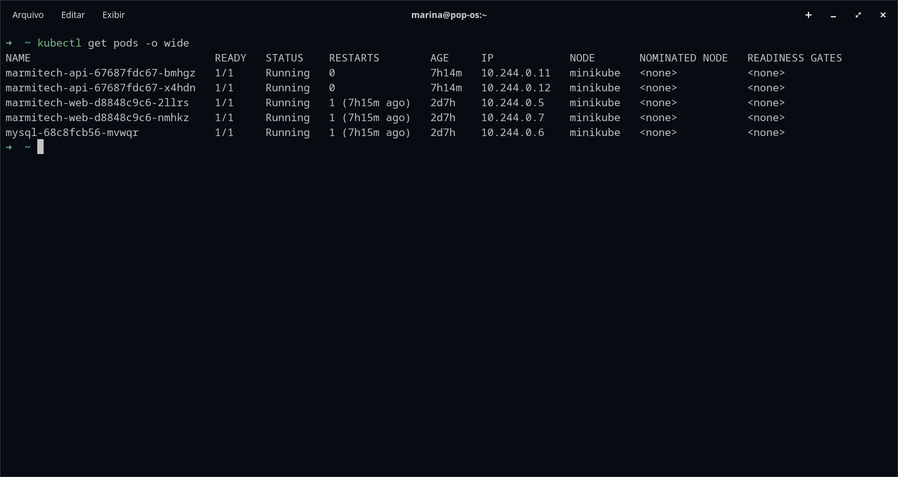
* **Services Criados:** 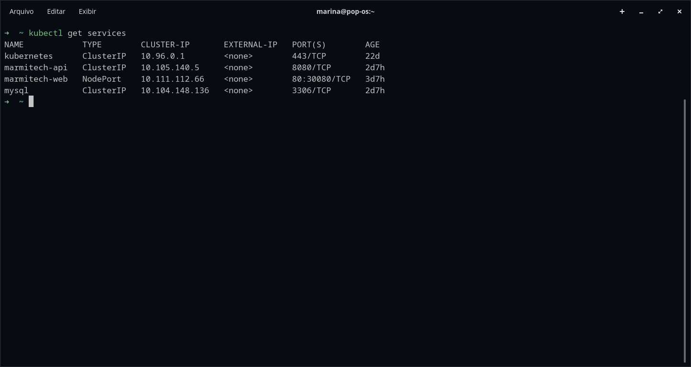
* **Deployments e Réplicas:** 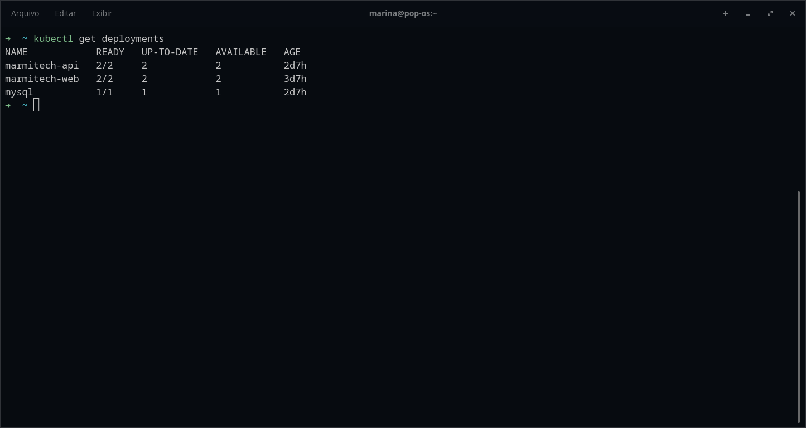
* **Balanceamento de Carga:** 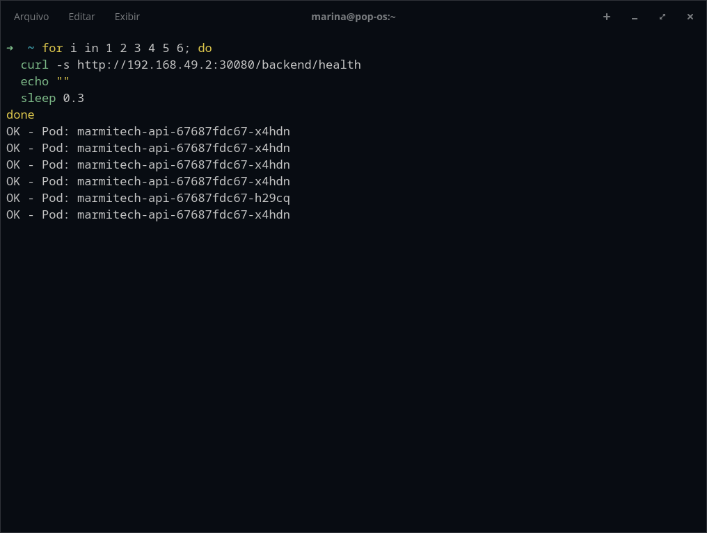
* **Exclusão de Pod (Self-Healing 1):** 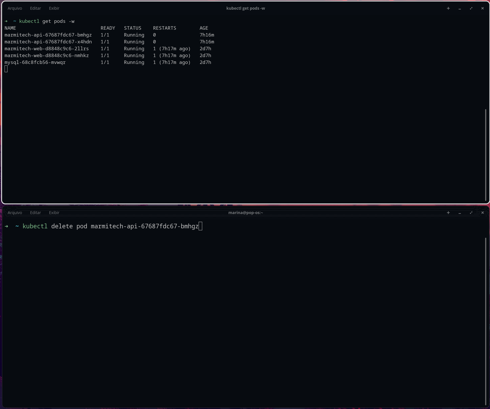
* **Recriação Automática (Self-Healing 2):** 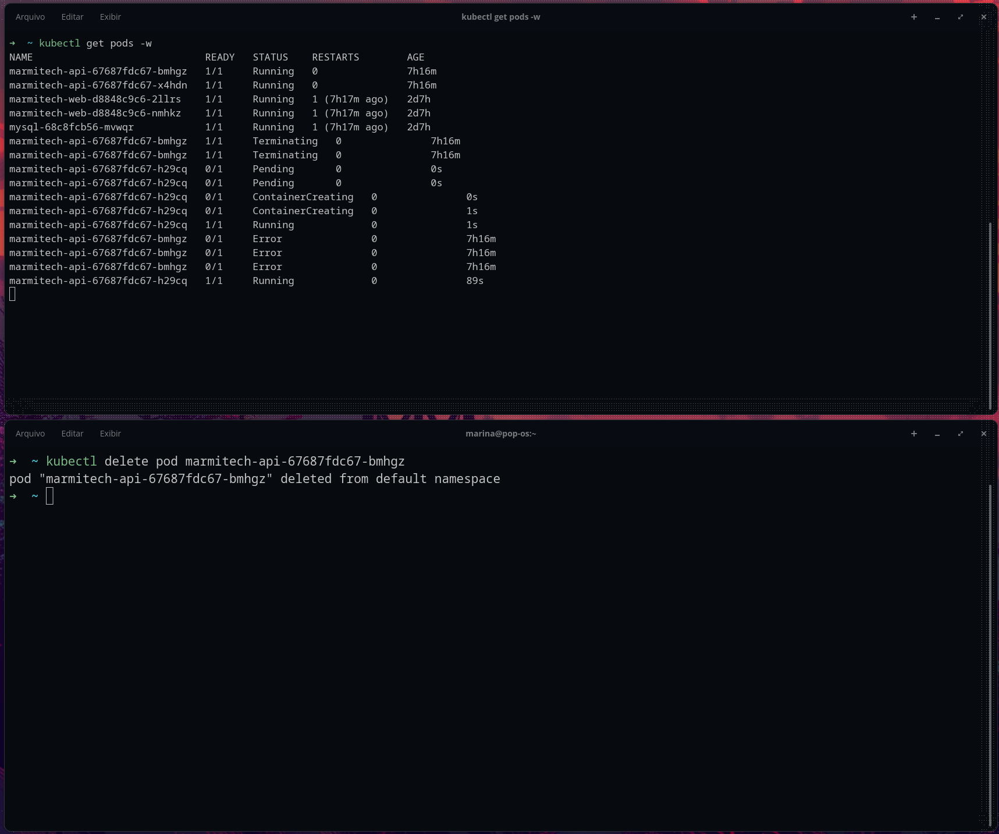

### Aplicação em Execução no Navegador

* **Tela de Login:** 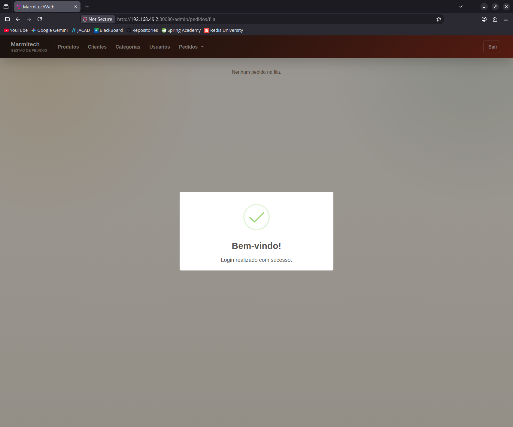
* **Cadastro de Cliente:** 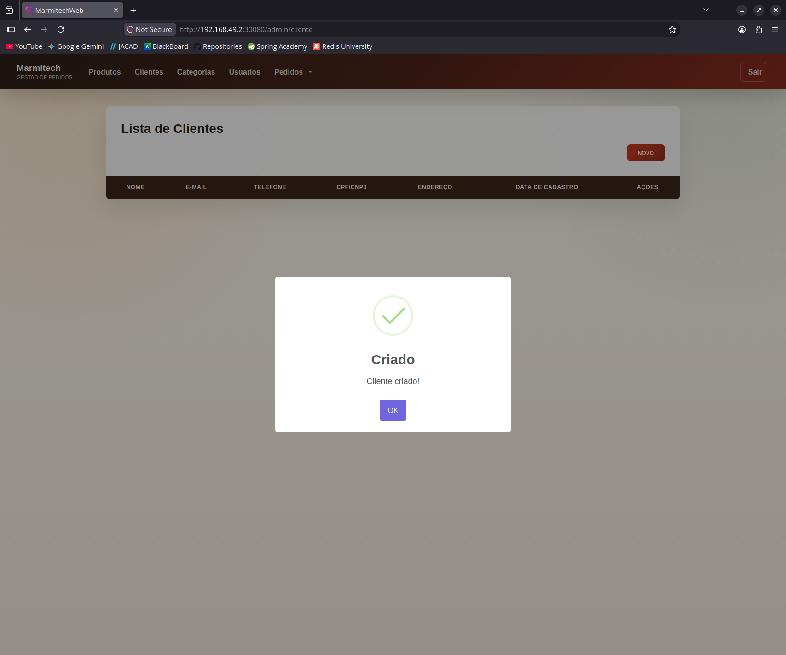
* **Cadastro de Produto:** 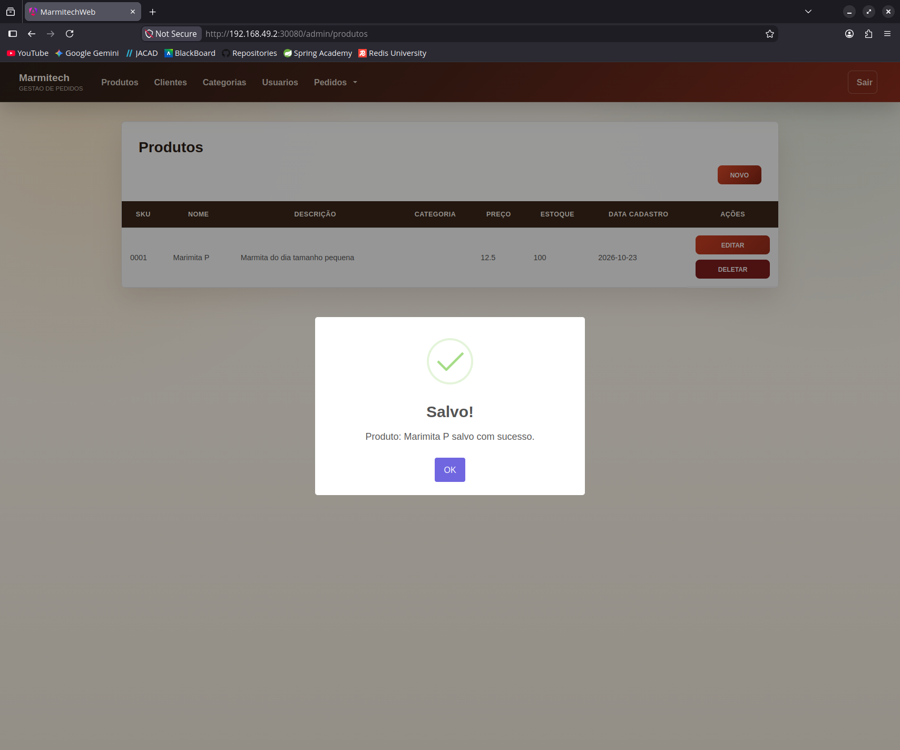
* **Criação de Pedido:** 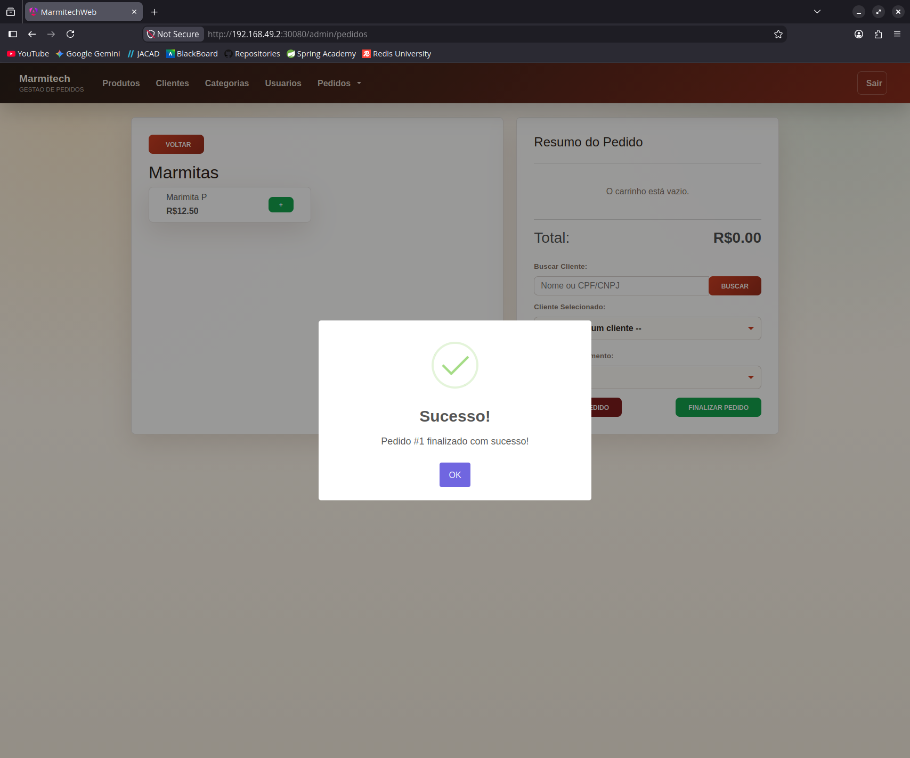
* **Fila de Pedidos em Tempo Real:** 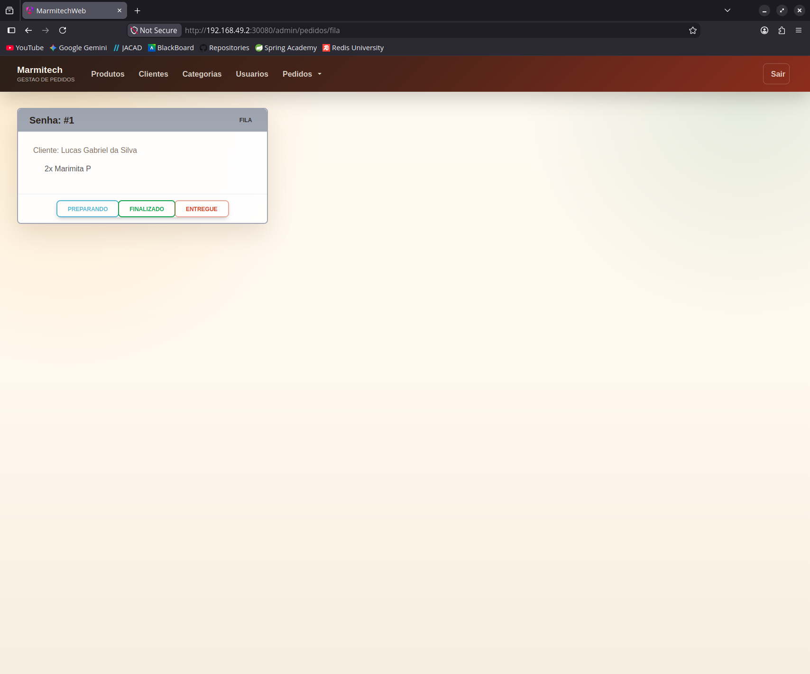
* **Histórico de Pedidos:** 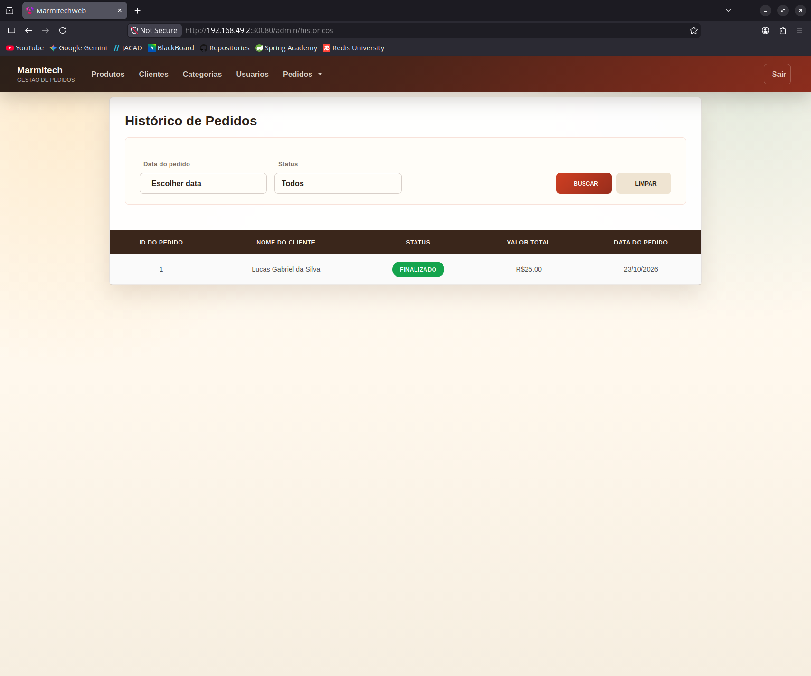
